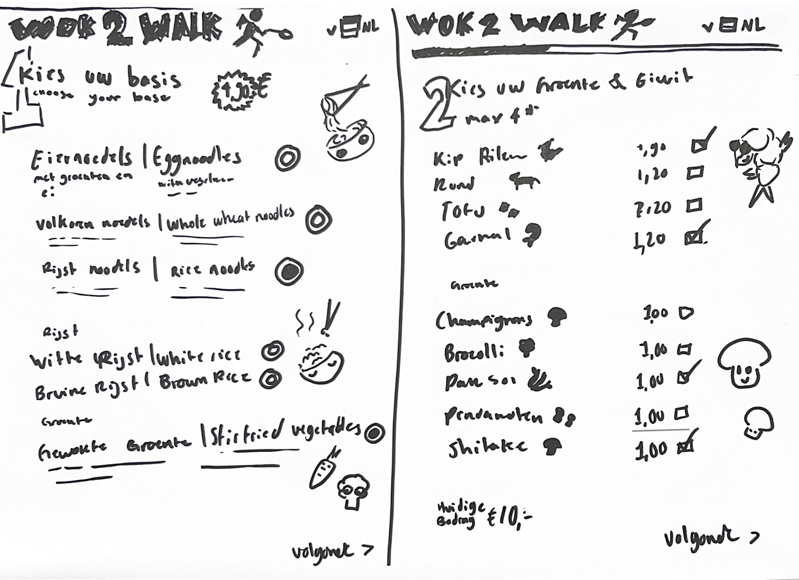
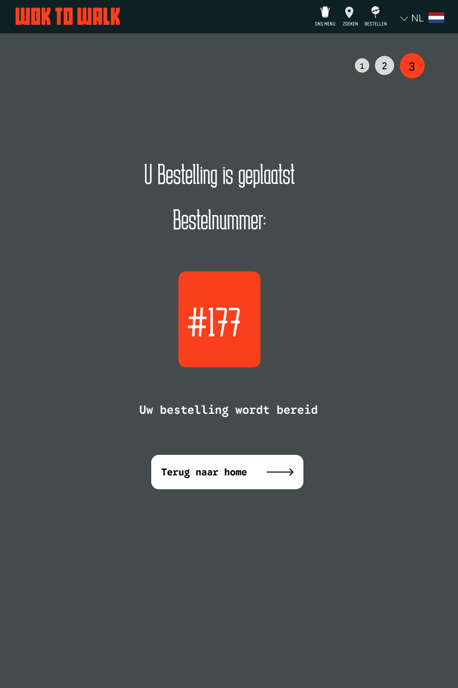
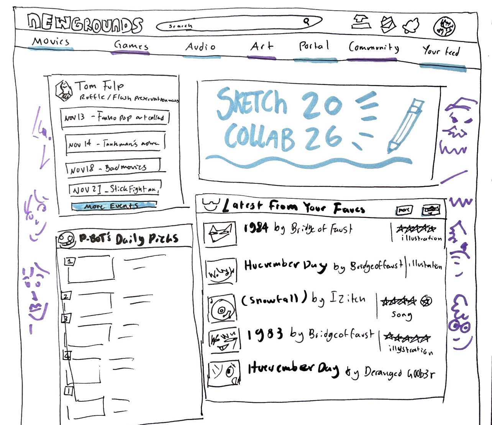
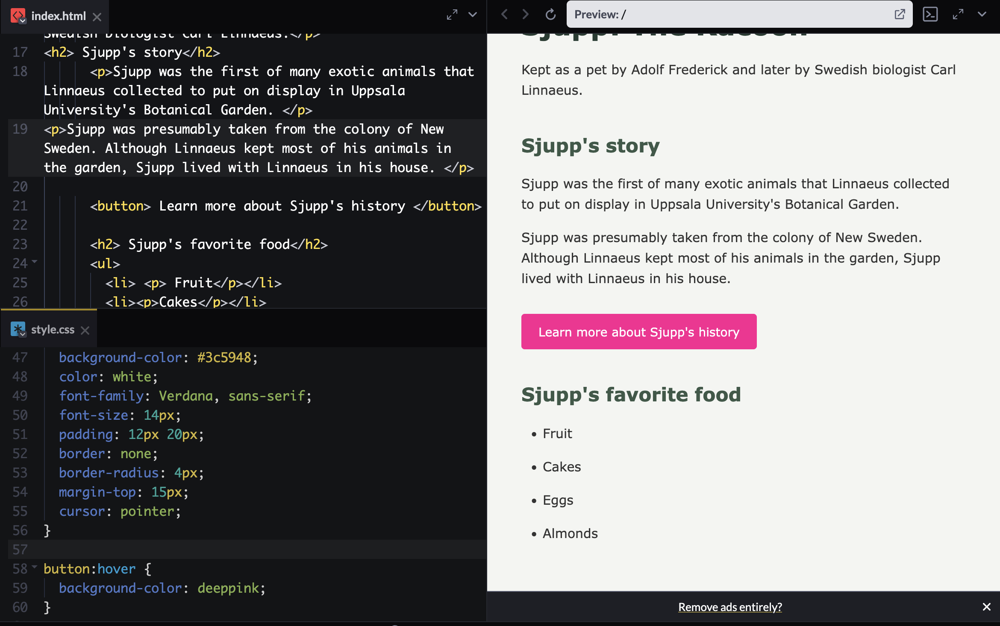
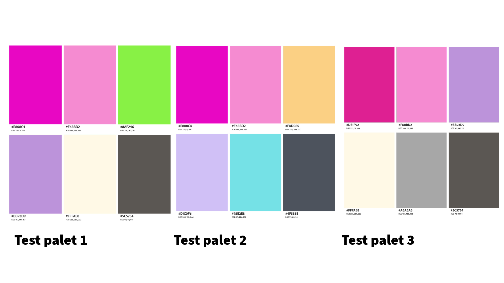
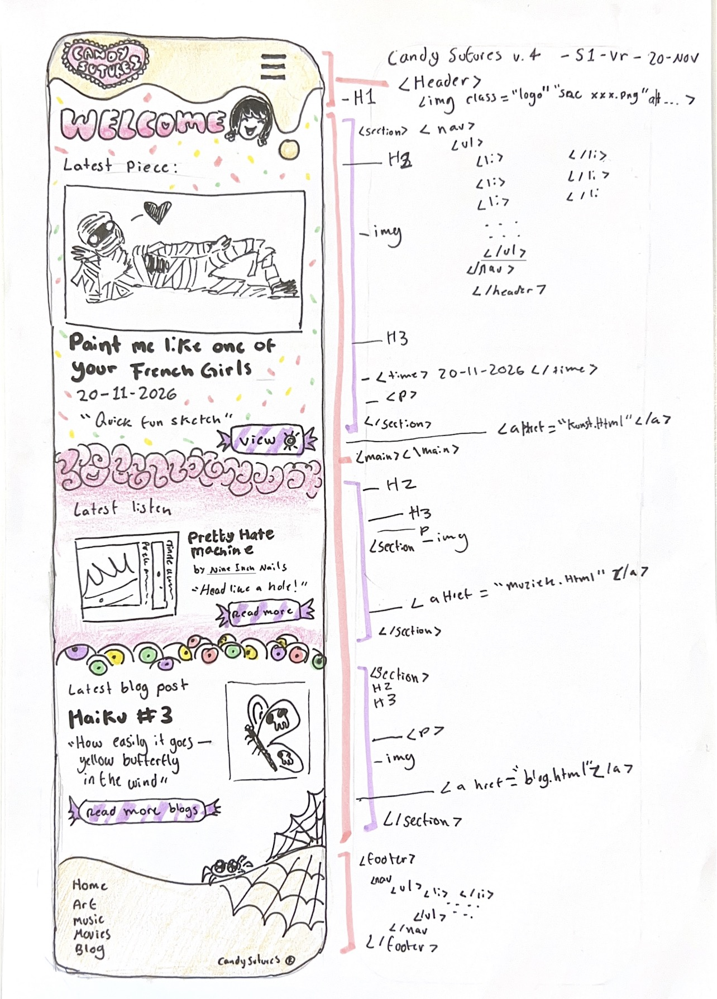

# Het web is voor iedereen — B2

**Naam:** Lucius Durañy Ramirez  
**Studentnummer:** 500927799 
**Klas:** 201

---

# Sprint 0

## Kick-off checkout

### Leg uit wat een source hosting platform is en voor welke jij gekozen hebt.

Een source hosting platform is een online platform waar je de code van je projecten kunt opslaan, beheren en delen. 

Voor dit project heb ik gekozen voor Github.

### Vertel welke domeinnaam jij gekozen hebt en hoe je die hebt gekoppeld aan jouw pagina.

Mijn gekozen domeinnaam is: CandySutures.nl.

Ik heb deze domeinnaam gekoppeld aan mijn website via TransIP.

### Publiceren van mijn website

Ik moest de stappen volgen op DLO en samen met Justus is het gelukt.

---

## S0 — Interactie: MMD, micro-interacties en forms

### Wok to Walk-menu

Voor deze opdracht heb ik gewerkt aan een interactief menu voor Wok to Walk. Hierbij heb ik nagedacht over de stappen die een gebruiker doorloopt bij het samenstellen van een bestelling.

**Eerste stap van het menu:**

### Low-fidelity schetsen

Eerst heb ik eenvoudige schetsen gemaakt om de indeling en werking van het formulier te bepalen.

### Mid-fidelity ontwerp

Daarna heb ik de schetsen verder uitgewerkt tot een duidelijker ontwerp. Hierbij heb ik de verschillende stappen van het formulier vormgegeven.

---

## S0 — Schetsen van interactie en animatie

### Schermschetsen

Voor deze oefening mocht ik zelf een website kiezen. Ik heb gekozen voor de homepage van Newgrounds, omdat ik het platform regelmatig gebruik en de vormgeving interessant vind.

### Animatieschets

Ik heb een aantal frames getekend voor een mogelijke animatie tijdens de loading state wanneer een gebruiker een bestelling plaatst.

---

## S0 — Praktische CSS

**Lelijke HTML:**

**Verbeterde HTML:**

---

## S0 — CSS: Fonts, kleuren en effecten

### Oefening 1 — Font properties

### Oefening 2 — Fonts, kleuren en effecten

### Oefening 3 — Mini-posters

### Oefening 4 — Transitions

---

# Sprint 1

## Maandag — Verkenning van het onderwerp

### Opdracht 1 — De meest webby website

Voor deze opdracht hebben wij digital gardens onderzocht en beoordeeld aan de hand van verschillende webby-onderdelen.

### Opdracht 2 — Eigen verkenning

#### Wat zou ik zelf willen maken?

Ik wil een persoonlijke website maken waar mijn kunst en interesses samenkomen.

Ik zou graag willen experimenteren met interactieve elementen, zoals bewegende icoontjes, kleine animaties, geluiden en verborgen details.

Ik heb nog niet veel ervaring met dit soort interactieve websites, maar ik vind het interessant om hier meer over te leren.

#### Welke webby-elementen wil ik gebruiken?

Ik wil vooral de volgende elementen gebruiken:

- **Responsive design:** De website moet goed werken op zowel mobiele telefoons als grote schermen.
- **Interactie:** Knoppen, bewegende icoontjes, hover-effecten en kleine verrassingen.
- **Animaties:** Kleine animaties die de website levendiger maken, zonder dat ze afleiden.
- **Visuele details:** Decoraties, patronen, illustraties en verwijzingen naar snoep en griezelige elementen.
- **Toegankelijkheid:** Goede kleurcontrasten, duidelijke tekst, alt-teksten bij afbeeldingen en bediening met een toetsenbord.

#### Welke eigen content kan ik maken?

Ik wil vooral persoonlijke content maken die te maken heeft met mijn interesses en creativiteit.

De website wordt een plek waar ik dingen kan bewaren, documenteren en delen. Denk bijvoorbeeld aan mijn eigen kunst, albumreviews, filmreviews, persoonlijke blogs en misschien reisverslagen.

#### Maak ik gebruik van content van anderen?

Ja, ik wil soms gebruikmaken van content van andere artiesten, zoals het delen van de content dat ik leuk vind (bijv muziek video).

Ook kan ik bestaande code als inspiratie of hulpmiddel gebruiken wanneer ik ergens niet uitkom. Hierbij vind ik het belangrijk om de oorspronkelijke maker te vermelden en credits te geven.

#### Hoe kan de content worden ervaren?

- **Zien:** Kleurrijke illustraties, collages, patronen, animaties en decoraties.
- **Horen:** Muziekfragmenten, ingesloten muziekvideo's en eventueel kleine geluidseffecten.
- **Lezen:** Persoonlijke blogs, albumreviews, filmreviews en verhalen.
- **Interactie:** Klikbare illustraties, interactieve menu's, hover-effecten en verborgen verrassingen.
- **Ontdekken:** Bezoekers kunnen zelf door verschillende categorieën bladeren en nieuwe content ontdekken.

### Opdracht 3 — Verzamelen van inspiratie

Voor deze opdracht heb ik verschillende websites, artiesten en visuele voorbeelden onderzocht. Deze inspiratie gebruik ik als basis voor mijn eigen Digital Garden.

Zie mijn presentatie voor een uitgebreid overzicht van mijn inspiratie en de 50 verzamelde afbeeldingen.

---

## Dinsdag — Light & Dark mode

Ik was deze dag afwezig. Ik ben van plan om de opdracht alsnog te maken, zodat ik ook kan oefenen met het ontwerpen van een light mode en dark mode.

---

## Woensdag — Visual Research

### Sfeerwoord: Sugar Rush

Mijn gekozen sfeerwoord is **Sugar Rush** (bedankt George!).

Dit woord past goed bij Candy Sutures vanwege de combinatie van zoete, kleurrijke en drukke elementen. Ik wil deze sfeer combineren met griezelige details en een nostalgische uitstraling.

### Miroboard — Visual Research

Samen met mijn groep heb ik visuele inspiratie verzameld en onderzocht.

[Bekijk het Miroboard](https://miro.com/app/board/uXjVEPuW9bg=/?share_link_id=478609892762)

### Crazy 8

Voor deze opdracht heb ik verschillende ideeën heel, heel snel geschetst. 

---

## Huiswerk — Mobile-first schetsen en mini-styleguide

### Mobile-first schetsen

### Kleurpaletten

Ik heb verschillende kleurcombinaties onderzocht om te bepalen welke kleuren het beste passen bij de sfeer van Candy Sutures.

### Typografie

Voor de typografie heb ik verschillende lettertypes onderzocht. Ik heb onderscheid gemaakt tussen lettertypes voor koppen en de gewone tekst.

Ik wil een combinatie vinden die expressief is en bij de stijl past, maar tegelijkertijd goed leesbaar blijft.

**Lettertypes voor koppen:**

**Lettertypes voor bodytekst:**

## Vrijdag Mobile first: van scherm schetsen naar HTML/CSS

### Zijn je schetsen Webby genoeg? Beoordeel o.b.v. het invulvel.
- Ik heb een menu, ik heb een aandachttrekkend landing page, maar niet genoeg interactieve elementen. Ook omdat ze lof schetssen zijn is het niet goed te zien dat het snoep is.

### Je hebt je opzet in html gemaakt. Bespreek met elkaar hoe schermontwerp kunt opbouwen/realiseren in html en css.
- Basisch beginnen, met de nav en content, daarna ga ik elementen digitaal tekenen, plaatsen in de images folder en positioneren met css

#### Feedback van schetsen.
- Kleur gebruiken voor scherm schetsen, tekst boxen (om te zien waar tekst begint), meer interactieve elementen (knoppen), custom cursor maken..
- Feedback docent: Motion reduction versie maken en vormgeving van de nav bij de eerste schets is het meest haalbaar.
- Maak waar nodig een laatste iteratie, zodat het helder is wat je definitieve bouwplan is in htm/css.

  

