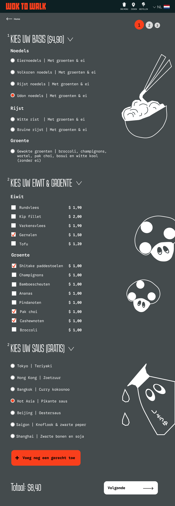
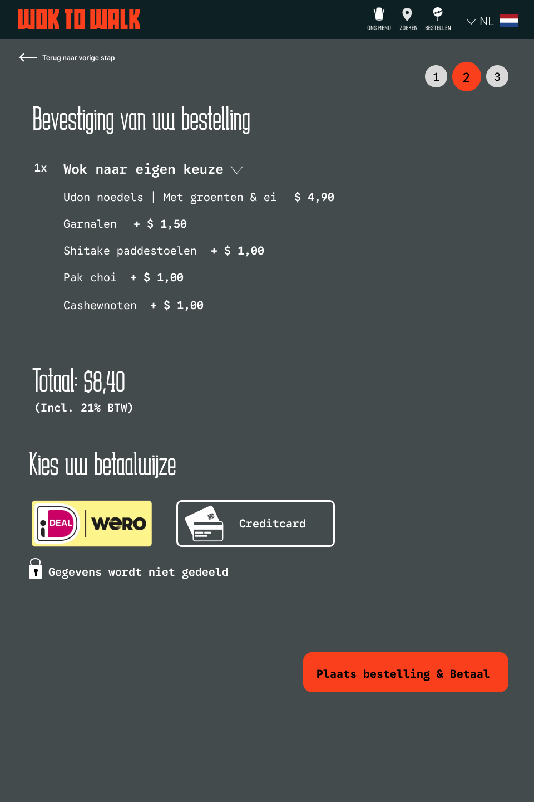
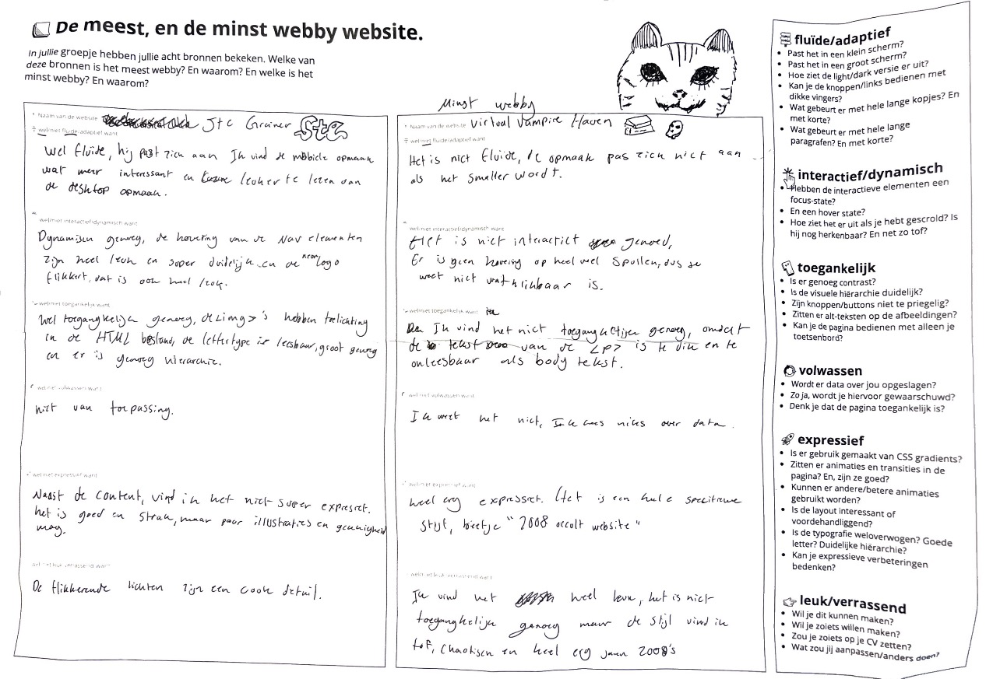
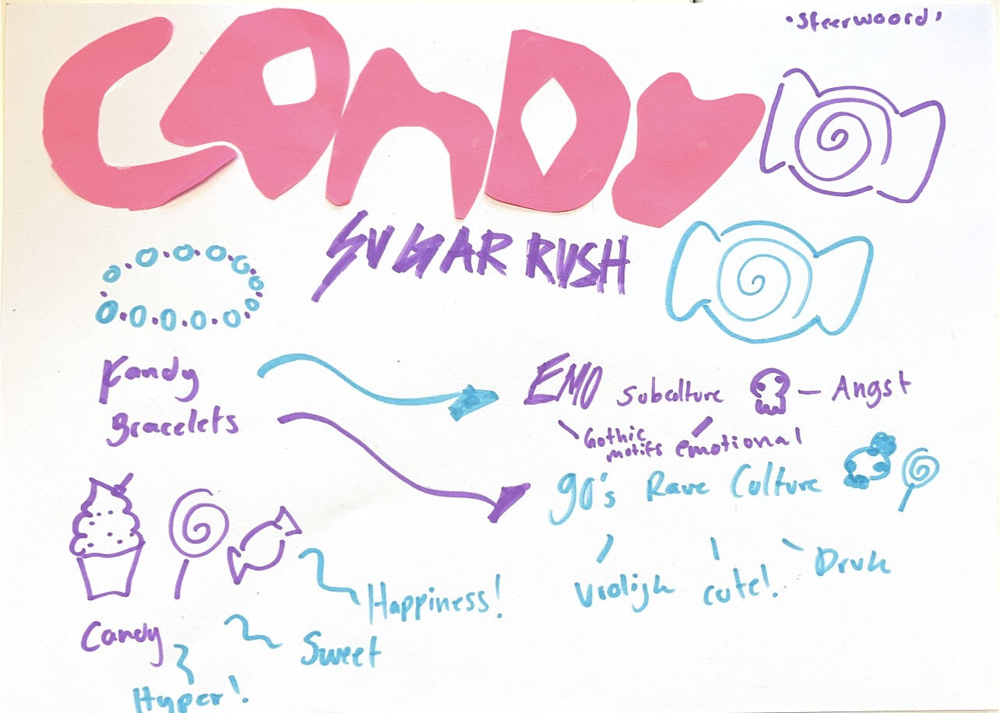

# Het web is voor iedereen — B2

**Naam:** Lucius Durañy Ramirez  
**Studentnummer:** 00000000  
**Klas:** 201

---

# Sprint 0

## Kick-off checkout

### Source hosting platform

Een source hosting platform is een online platform waar je de code van je projecten kunt opslaan, beheren en delen. Het maakt het mogelijk om wijzigingen bij te houden en samen te werken met anderen.

Voor dit project heb ik gekozen voor **[NAAM PLATFORM, bijvoorbeeld GitHub]**.

### Domeinnaam

Mijn gekozen domeinnaam is: CandySutures.nl.

Ik heb deze domeinnaam gekoppeld aan mijn website via TransIP.

### Publiceren van mijn website

Ik moest de stappen volgen op DLO en samen met Justus is het gelukt.

---

## S0 — Interactie: MMD, micro-interacties en forms

### Wok to Walk-menu

Voor deze opdracht heb ik gewerkt aan een interactief menu voor Wok to Walk. Hierbij heb ik nagedacht over de stappen die een gebruiker doorloopt bij het samenstellen van een bestelling.

**Eerste stap van het menu:**

### Low-fidelity schetsen

Eerst heb ik eenvoudige schetsen gemaakt om de indeling en werking van het formulier te bepalen.

### Mid-fidelity ontwerp

Daarna heb ik de schetsen verder uitgewerkt tot een duidelijker ontwerp. Hierbij heb ik de verschillende stappen van het formulier vormgegeven.

---

## S0 — Schetsen van interactie en animatie

### Schermschetsen

Voor deze oefening mocht ik zelf een website kiezen. Ik heb gekozen voor de homepage van Newgrounds, omdat ik het platform regelmatig gebruik en de vormgeving interessant vind.

### Animatieschets

Ik heb een aantal frames getekend voor een mogelijke animatie tijdens de laadstatus (loading state) wanneer een gebruiker een bestelling plaatst.

---

## S0 — Praktische CSS

Tijdens deze oefening heb ik geoefend met het toepassen van CSS op HTML-elementen. Ik heb verschillende versies gemaakt om het verschil te zien tussen een eenvoudige HTML-pagina en een pagina met CSS.

**Eerste versie:**

**Verbeterde versie:**

---

## S0 — CSS: Fonts, kleuren en effecten

### Oefening 1 — Font properties

Tijdens deze oefening heb ik verschillende CSS-eigenschappen voor typografie uitgeprobeerd.

### Oefening 2 — Fonts, kleuren en effecten

Hier heb ik geëxperimenteerd met verschillende lettertypes, kleuren en visuele effecten.

### Oefening 3 — Mini-posters

Voor deze opdracht heb ik twee mini-posters gemaakt. Hierbij heb ik gespeeld met typografie, kleur en compositie.

### Oefening 4 — Transitions

Ik heb transitions gebruikt om interactieve veranderingen zichtbaar te maken wanneer je met de muis over een element beweegt.

---

# Sprint 1

## Maandag — Verkenning van het onderwerp

### Opdracht 1 — De meest webby website

Voor deze opdracht heb ik een website onderzocht en beoordeeld aan de hand van verschillende webby-onderdelen.

### Opdracht 2 — Eigen verkenning

#### Wat zou ik zelf willen maken?

Ik wil een persoonlijke website maken waar mijn kunst en interesses samenkomen.

Ik zou graag willen experimenteren met interactieve elementen, zoals bewegende icoontjes, kleine animaties, geluiden en verborgen details.

Ik heb nog niet veel ervaring met dit soort interactieve websites, maar ik vind het interessant om hier meer over te leren.

#### Welke webby-elementen wil ik gebruiken?

Ik wil vooral de volgende elementen gebruiken:

- **Responsive design:** De website moet goed werken op zowel mobiele telefoons als grote schermen.
- **Interactie:** Knoppen, bewegende icoontjes, hover-effecten en kleine verrassingen.
- **Animaties:** Kleine animaties die de website levendiger maken, zonder dat ze afleiden.
- **Visuele details:** Decoraties, patronen, illustraties en verwijzingen naar snoep en griezelige elementen.
- **Toegankelijkheid:** Goede kleurcontrasten, duidelijke tekst, alt-teksten bij afbeeldingen en bediening met een toetsenbord.

#### Welke eigen content kan ik maken?

Ik wil vooral persoonlijke content maken die te maken heeft met mijn interesses en creativiteit.

De website wordt een plek waar ik dingen kan bewaren, documenteren en delen. Denk bijvoorbeeld aan mijn eigen kunst, albumreviews, filmreviews, persoonlijke blogs en reisverslagen.

#### Maak ik gebruik van content van anderen?

Ja, ik wil soms gebruikmaken van content van andere artiesten en makers. Denk bijvoorbeeld aan muziekvideo's, YouTube-video's, afbeeldingen en links naar andere websites.

Ook kan ik bestaande code als inspiratie of hulpmiddel gebruiken wanneer ik ergens niet uitkom. Hierbij vind ik het belangrijk om de oorspronkelijke maker te vermelden en credits te geven.

Ik wil rekening houden met auteursrechten en geen werk van anderen zomaar overnemen. Waar nodig vraag ik toestemming of gebruik ik content waarvoor ik toestemming heb.

Ik kan bestaande content ook combineren met mijn eigen mening en ervaringen. Bijvoorbeeld door een album te bespreken of uit te leggen waarom een bepaalde artiest mij inspireert.

#### Hoe kan de content worden ervaren?

Ik wil dat Candy Sutures meer is dan alleen een website met tekst en afbeeldingen. De website moet een bepaalde sfeer en beleving hebben.

- **Zien:** Kleurrijke illustraties, collages, patronen, animaties en decoraties.
- **Horen:** Muziekfragmenten, ingesloten muziekvideo's en eventueel kleine geluidseffecten.
- **Lezen:** Persoonlijke blogs, albumreviews, filmreviews en verhalen.
- **Interactie:** Klikbare illustraties, interactieve menu's, hover-effecten en verborgen verrassingen.
- **Ontdekken:** Bezoekers kunnen zelf door verschillende categorieën bladeren en nieuwe content ontdekken.

### Opdracht 3 — Verzamelen van inspiratie

Voor deze opdracht heb ik verschillende websites, artiesten en visuele voorbeelden onderzocht. Deze inspiratie gebruik ik als basis voor mijn eigen Digital Garden.

Zie mijn presentatie voor een uitgebreid overzicht van mijn inspiratie en de 50 verzamelde afbeeldingen.

---

## Dinsdag — Light & Dark mode

Ik was deze dag afwezig. Ik ben van plan om de opdracht alsnog te maken, zodat ik ook kan oefenen met het ontwerpen van een light mode en dark mode.

---

## Woensdag — Visual Research

### Sfeerwoord: Sugar Rush

Mijn gekozen sfeerwoord is **Sugar Rush** (bedankt George!).

Dit woord past goed bij Candy Sutures vanwege de combinatie van zoete, kleurrijke en drukke elementen. Ik wil deze sfeer combineren met griezelige details en een nostalgische uitstraling.

### Miroboard — Visual Research

Samen met mijn groep heb ik visuele inspiratie verzameld en onderzocht.

[Bekijk het Miroboard](https://miro.com/app/board/uXjVEPuW9bg=/?share_link_id=478609892762)

### Crazy 8

Voor deze opdracht heb ik verschillende ideeën snel geschetst. Het doel was om in korte tijd meerdere mogelijke richtingen voor het ontwerp te bedenken.

---

## Huiswerk — Mobile-first schetsen en mini-styleguide

### Mobile-first schetsen

Ik ben begonnen met het ontwerpen voor een mobiel scherm. Hierbij heb ik nagedacht over de indeling, navigatie en manier waarop bezoekers door de website kunnen bladeren.

### Kleurpaletten

Ik heb verschillende kleurcombinaties onderzocht om te bepalen welke kleuren het beste passen bij de sfeer van Candy Sutures.

### Typografie

Voor de typografie heb ik verschillende lettertypes onderzocht. Ik heb onderscheid gemaakt tussen lettertypes voor koppen en de gewone tekst.

Ik wil een combinatie vinden die expressief is en bij de stijl past, maar tegelijkertijd goed leesbaar blijft.

**Lettertypes voor koppen:**

**Lettertypes voor bodytekst:**

---

# Project: Candy Sutures

Mijn uiteindelijke concept is een persoonlijke Digital Garden onder de naam **Candy Sutures**.

De website combineert mijn interesses in kunst, muziek, films en persoonlijke verhalen. De visuele stijl is geïnspireerd door de emo- en DIY-subcultuur, nostalgische websites uit de jaren 2000 en de combinatie van schattige en griezelige elementen.

Mijn doel is om een persoonlijke digitale wereld te maken die niet alleen mijn interesses laat zien, maar ook mijn eigen stijl en persoonlijkheid weerspiegelt.
