# Het web is voor iedereen — B2

**Naam:** Lucius Durañy Ramirez  
**Studentnummer:** 500927799 
**Klas:** 201

---

# Sprint 0

## Kick-off checkout

### Leg uit wat een source hosting platform is en voor welke jij gekozen hebt.

Een source hosting platform is een online platform waar je de code van je projecten kunt opslaan, beheren en delen. 

Voor dit project heb ik gekozen voor Github.

### Vertel welke domeinnaam jij gekozen hebt en hoe je die hebt gekoppeld aan jouw pagina.

Mijn gekozen domeinnaam is: CandySutures.nl.

Ik heb deze domeinnaam gekoppeld aan mijn website via TransIP.

### Publiceren van mijn website

Ik moest de stappen volgen op DLO en samen met Justus is het gelukt.

---

## S0 — Interactie: MMD, micro-interacties en forms

### Wok to Walk-menu

Voor deze opdracht heb ik gewerkt aan een interactief menu voor Wok to Walk. Hierbij heb ik nagedacht over de stappen die een gebruiker doorloopt bij het samenstellen van een bestelling.

**Eerste stap van het menu:**

### Low-fidelity schetsen

Eerst heb ik eenvoudige schetsen gemaakt om de indeling en werking van het formulier te bepalen.

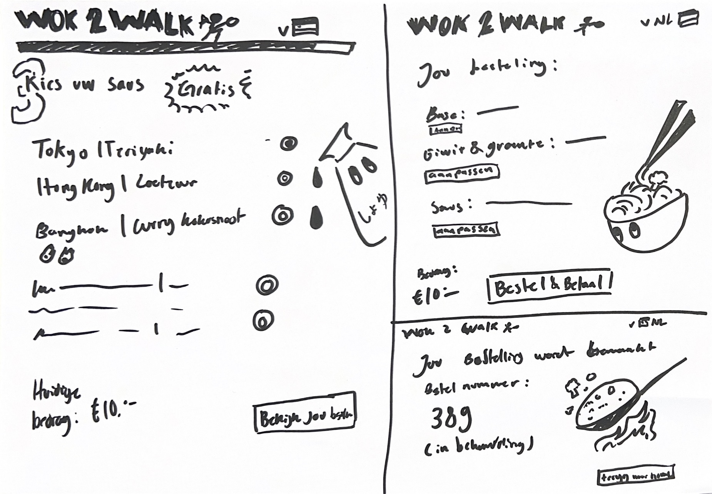

### Mid-fidelity ontwerp

Daarna heb ik de schetsen verder uitgewerkt tot een duidelijker ontwerp. Hierbij heb ik de verschillende stappen van het formulier vormgegeven.

---

## S0 — Schetsen van interactie en animatie

### Schermschetsen

Voor deze oefening mocht ik zelf een website kiezen. Ik heb gekozen voor de homepage van Newgrounds, omdat ik het platform regelmatig gebruik en de vormgeving interessant vind.

### Animatieschets

Ik heb een aantal frames getekend voor een mogelijke animatie tijdens de loading state wanneer een gebruiker een bestelling plaatst.

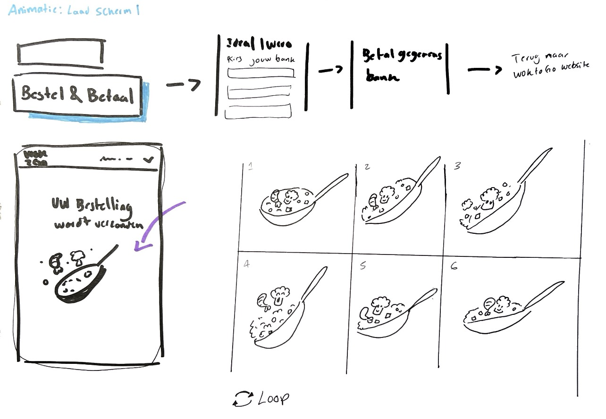

---

## S0 — Praktische CSS

**Lelijke HTML:**

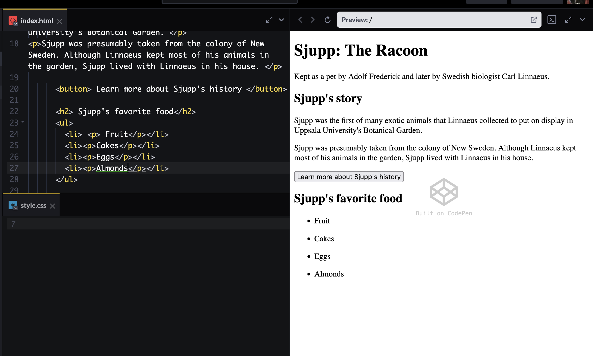

**Verbeterde HTML:**

---

## S0 — CSS: Fonts, kleuren en effecten

### Oefening 1 — Font properties

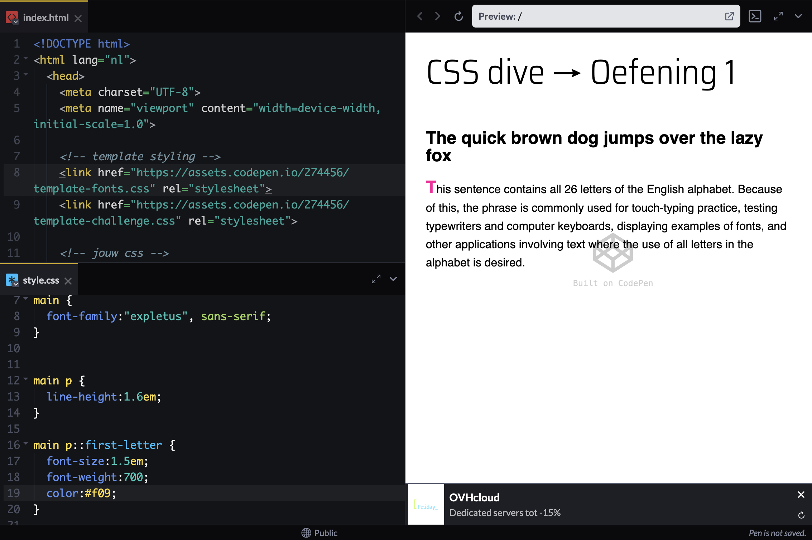

### Oefening 2 — Fonts, kleuren en effecten

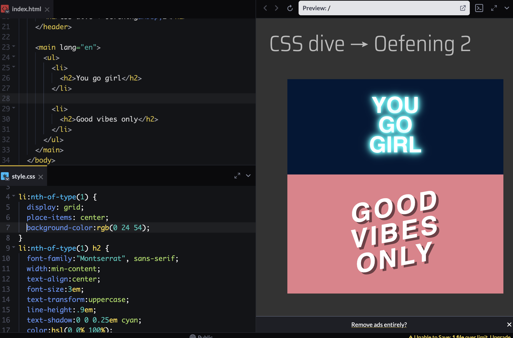

### Oefening 3 — Mini-posters

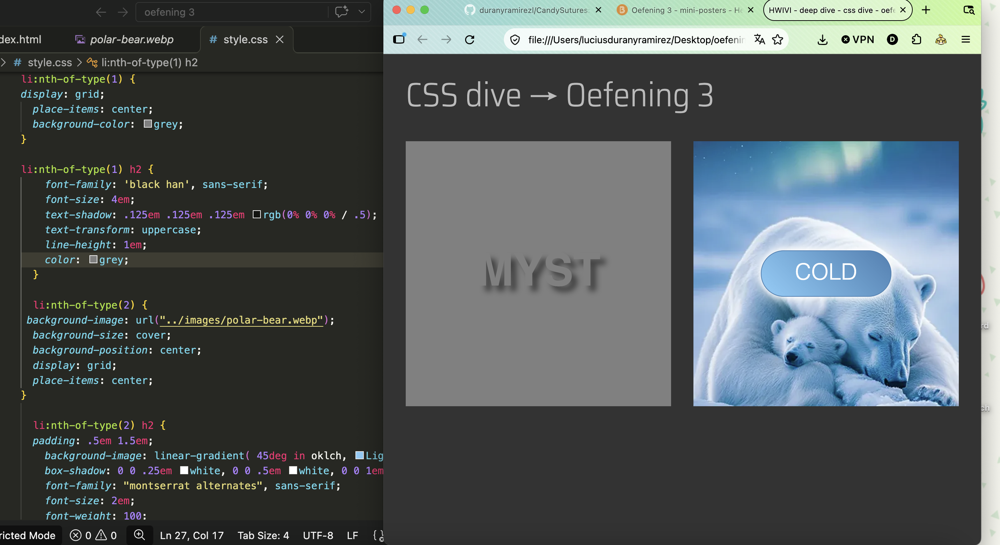

### Oefening 4 — Transitions lol

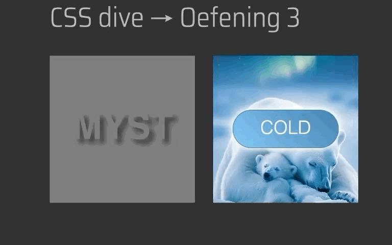

---

# Sprint 1

## Maandag — Verkenning van het onderwerp

### Opdracht 1 — De meest webby website

Voor deze opdracht hebben wij digital gardens onderzocht en beoordeeld aan de hand van verschillende webby-onderdelen.

### Opdracht 2 — Eigen verkenning

#### Wat zou ik zelf willen maken?

Ik wil een persoonlijke website maken waar mijn kunst en interesses samenkomen.

Ik zou graag willen experimenteren met interactieve elementen, zoals bewegende icoontjes, kleine animaties, geluiden en verborgen details.

Ik heb nog niet veel ervaring met dit soort interactieve websites, maar ik vind het interessant om hier meer over te leren.

#### Welke webby-elementen wil ik gebruiken?

Ik wil vooral de volgende elementen gebruiken:

- **Responsive design:** De website moet goed werken op zowel mobiele telefoons als grote schermen.
- **Interactie:** Knoppen, bewegende icoontjes, hover-effecten en kleine verrassingen.
- **Animaties:** Kleine animaties die de website levendiger maken, zonder dat ze afleiden.
- **Visuele details:** Decoraties, patronen, illustraties en verwijzingen naar snoep en griezelige elementen.
- **Toegankelijkheid:** Goede kleurcontrasten, duidelijke tekst, alt-teksten bij afbeeldingen en bediening met een toetsenbord.

#### Welke eigen content kan ik maken?

Ik wil vooral persoonlijke content maken die te maken heeft met mijn interesses en creativiteit.

De website wordt een plek waar ik dingen kan bewaren, documenteren en delen. Denk bijvoorbeeld aan mijn eigen kunst, albumreviews, filmreviews, persoonlijke blogs en misschien reisverslagen.

#### Maak ik gebruik van content van anderen?

Ja, ik wil soms gebruikmaken van content van andere artiesten, zoals het delen van de content dat ik leuk vind (bijv muziek video).

Ook kan ik bestaande code als inspiratie of hulpmiddel gebruiken wanneer ik ergens niet uitkom. Hierbij vind ik het belangrijk om de oorspronkelijke maker te vermelden en credits te geven.

#### Hoe kan de content worden ervaren?

- **Zien:** Kleurrijke illustraties, collages, patronen, animaties en decoraties.
- **Horen:** Muziekfragmenten, ingesloten muziekvideo's en eventueel kleine geluidseffecten.
- **Lezen:** Persoonlijke blogs, albumreviews, filmreviews en verhalen.
- **Interactie:** Klikbare illustraties, interactieve menu's, hover-effecten en verborgen verrassingen.
- **Ontdekken:** Bezoekers kunnen zelf door verschillende categorieën bladeren en nieuwe content ontdekken.

### Opdracht 3 — Verzamelen van inspiratie

Voor deze opdracht heb ik verschillende websites, artiesten en visuele voorbeelden onderzocht. Deze inspiratie gebruik ik als basis voor mijn eigen Digital Garden.

Zie mijn presentatie voor een uitgebreid overzicht van mijn inspiratie en de 50 verzamelde afbeeldingen.

---

## Dinsdag — Light & Dark mode

Ik was deze dag afwezig. Ik ben van plan om de opdracht alsnog te maken, zodat ik ook kan oefenen met het ontwerpen van een light mode en dark mode.

---

## Woensdag — Visual Research

### Sfeerwoord: Sugar Rush

Mijn gekozen sfeerwoord is **Sugar Rush** (bedankt George!).

Dit woord past goed bij Candy Sutures vanwege de combinatie van zoete, kleurrijke en drukke elementen. Ik wil deze sfeer combineren met griezelige details en een nostalgische uitstraling.

### Miroboard — Visual Research

Samen met mijn groep heb ik visuele inspiratie verzameld en onderzocht.

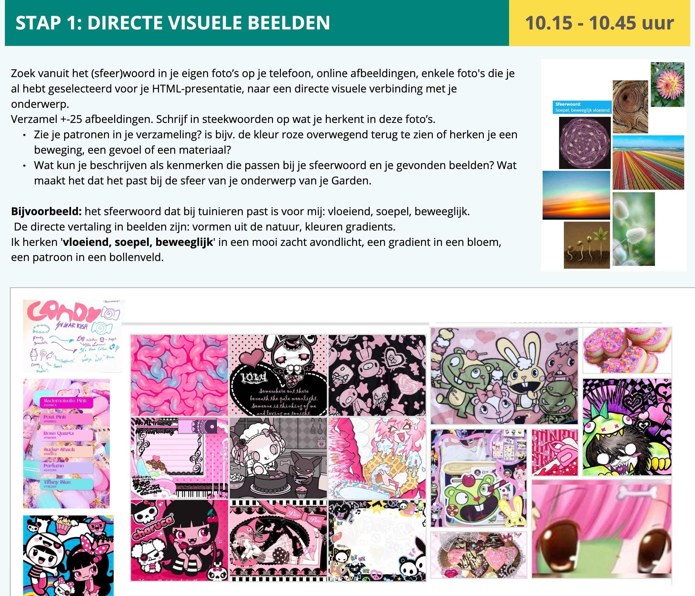
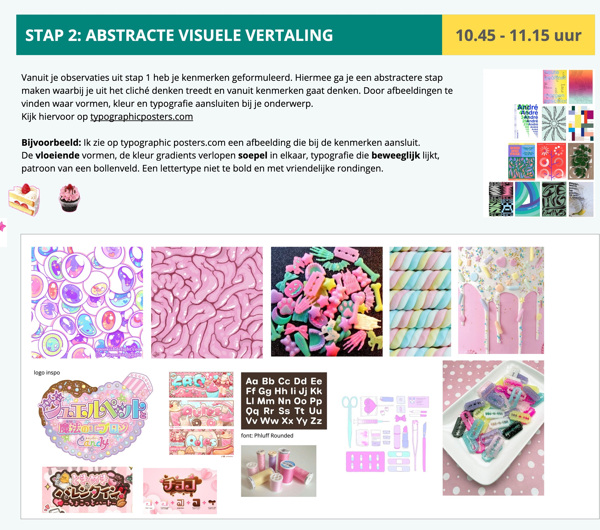
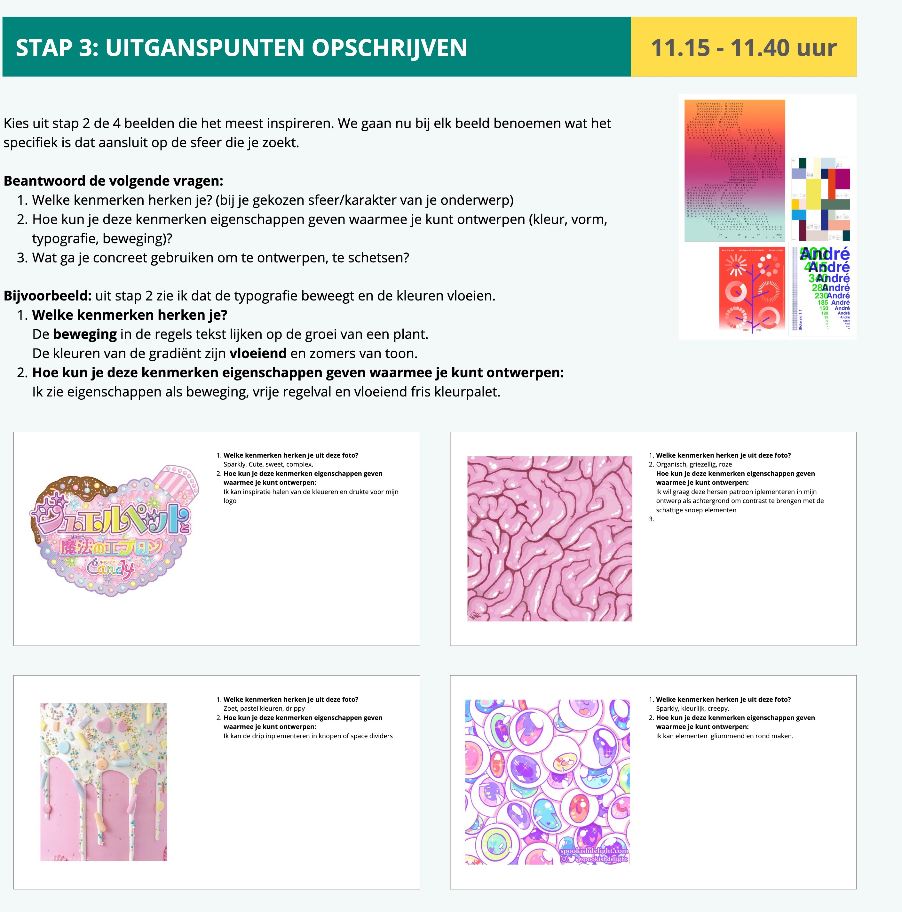

[Bekijk het Miroboard](https://miro.com/app/board/uXjVEPuW9bg=/?share_link_id=478609892762)

### Crazy 8

Voor deze opdracht heb ik verschillende ideeën heel, heel snel geschetst. 
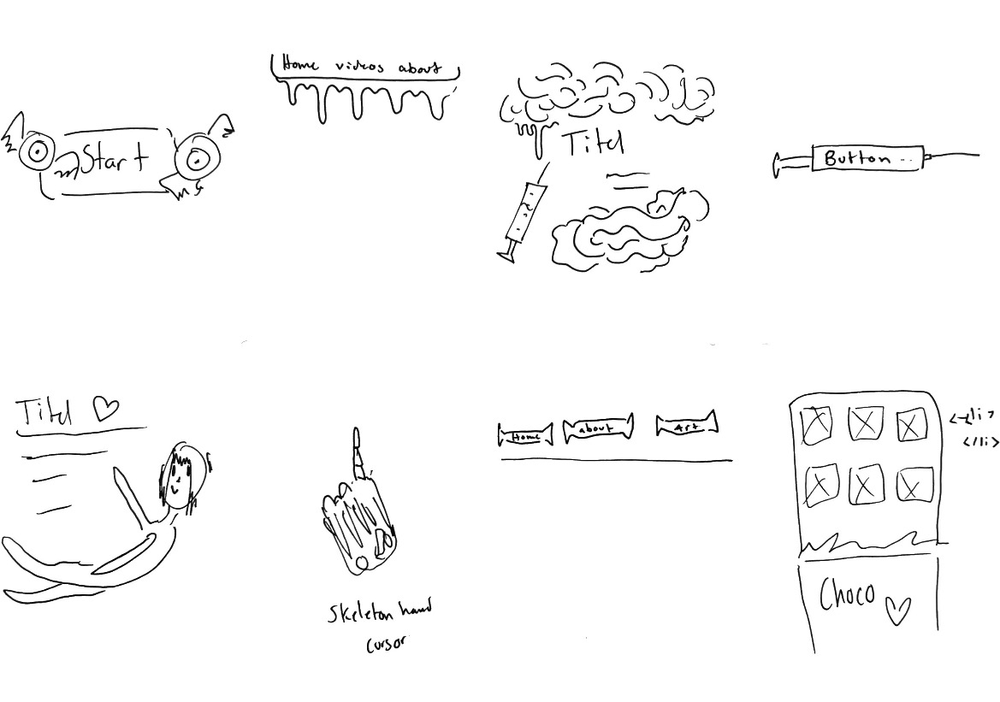

---

## Huiswerk — Mobile-first schetsen en mini-styleguide

### Mobile-first schetsen

### Kleurpaletten

Ik heb verschillende kleurcombinaties onderzocht om te bepalen welke kleuren het beste passen bij de sfeer van Candy Sutures.

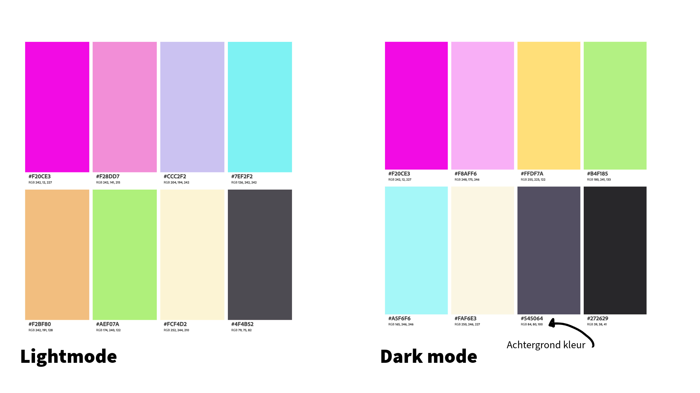

### Typografie

Voor de typografie heb ik verschillende lettertypes onderzocht. Ik heb onderscheid gemaakt tussen lettertypes voor koppen en de gewone tekst.

Ik wil een combinatie vinden die expressief is en bij de stijl past, maar tegelijkertijd goed leesbaar blijft.

**Lettertypes voor koppen:**

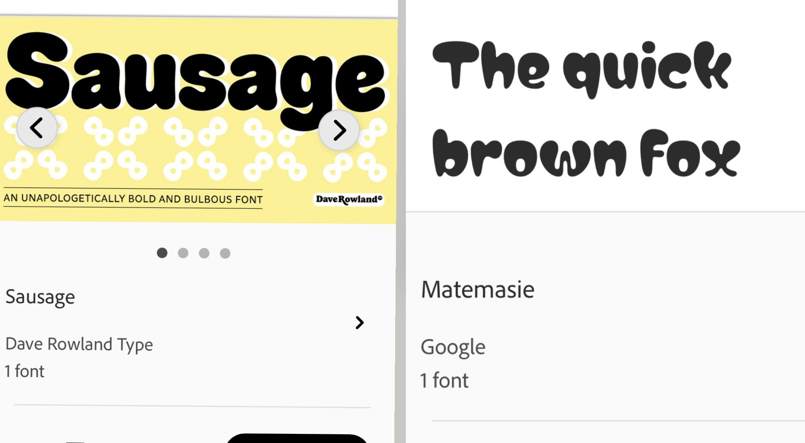

**Lettertypes voor bodytekst:**

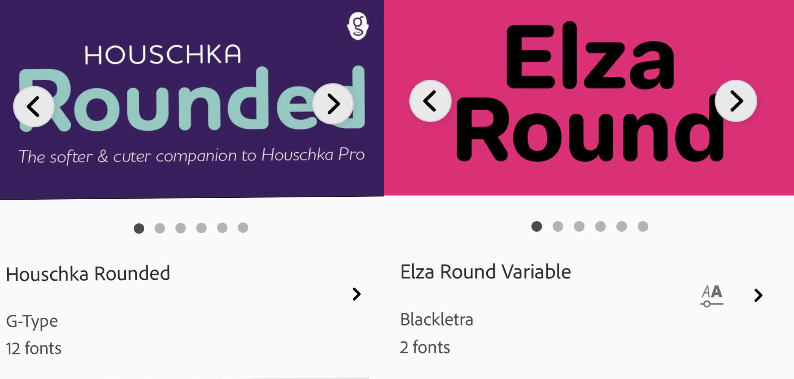

## Vrijdag Mobile first: van scherm schetsen naar HTML/CSS

### Zijn je schetsen Webby genoeg? Beoordeel o.b.v. het invulvel.
- Ik heb een menu, ik heb een aandachttrekkend landing page, maar niet genoeg interactieve elementen. Ook omdat ze lof schetssen zijn is het niet goed te zien dat het snoep is.

### Je hebt je opzet in html gemaakt. Bespreek met elkaar hoe schermontwerp kunt opbouwen/realiseren in html en css.
- Basisch beginnen, met de nav en content, daarna ga ik elementen digitaal tekenen, plaatsen in de images folder en positioneren met css

#### Feedback van schetsen.
- Kleur gebruiken voor scherm schetsen, tekst boxen (om te zien waar tekst begint), meer interactieve elementen (knoppen), custom cursor maken..
- Feedback docent: Motion reduction versie maken en vormgeving van de nav bij de eerste schets is het meest haalbaar.
- Maak waar nodig een laatste iteratie, zodat het helder is wat je definitieve bouwplan is in htm/css.

  

## Sprint 0 en 1 Competentie Checkout

  
### Oriënteren en begrijpen

Ik begrijp dat deze opdracht bedoeld is om mijn kennis van HTML en CSS te verbeteren en om te leren hoe ik een website kan ontwerpen die niet alleen mooi is, maar ook goed werkt voor verschillende gebruikers. Ik heb tijdens Sprint 1 kennisgemaakt met verschillende CSS-eigenschappen, zoals typografie, kleuren, effecten en transitions. Ook heb ik geoefend met interactie en formulieren, bijvoorbeeld bij het Wok to Walk-menu in sprint 0. Voor mijn eigen project heb ik gekozen voor Candy Sutures, een persoonlijke Digital Garden waar ik mijn kunst en interesses wil verzamelen. 

### Verbeelden en conceptualiseren
Tijdens mijn proces heb ik verschillende ideeën onderzocht en uitgewerkt. Bij Sprint 0 heb ik bijvoorbeeld de homepage van Newgrounds geschetst en een mogelijke loading-state-animatie getekend. Voor het Wok to Walk-menu heb ik eerst low-fidelity schetsen gemaakt en deze daarna uitgewerkt tot een mid-fidelity ontwerp. 

Voor Candy Sutures heb ik inspiratie verzameld, een Crazy 8-oefening gedaan en verschillende mobile-first schetsen gemaakt. Ook heb ik meerdere kleurpaletten en lettertypes onderzocht. Mijn belangrijkste inspiratie komt uit de Japanse game Fukuomori, de emo- en DIY-subcultuur en persoonlijke websites uit de jaren 2000. Ik wil vooral experimenteren met een combinatie van schattige en griezelige elementen. Ik heb nog niet alle ideeën technisch uitgewerkt, maar door te schetsen en verschillende richtingen te onderzoeken krijg ik steeds een duidelijker beeld van wat ik wil maken. Ik wil bijvoorbeeld nog leren hoe ik kleine animaties, interactieve illustraties en verborgen details kan toevoegen.

### Prototypen en uitwerken

Ik heb tijdens de eerste sprint verschillende ontwerpen en oefeningen uitgewerkt. Bij het Wok to Walk-menu heb ik mijn eerste schetsen omgezet naar een duidelijker mid-fidelity ontwerp. Ook heb ik verschillende CSS-oefeningen gemaakt, waarbij ik heb geëxperimenteerd met fonts, kleuren, visuele effecten en transitions. Hierdoor begrijp ik beter hoe CSS de uitstraling en interactie van een website kan veranderen. Voor 

Candy Sutures heb ik mijn eerste mobile-first schetsen, kleurpaletten en typografiekeuzes gemaakt. Ik heb ook een schets gemaakt met verschillende html elementen om mij te helpen om de website daadwerkelijk te coderen.

### Evalueren
Tijdens dit proces heb ik gemerkt dat schetsen en experimenteren mij helpen om mijn ideeën duidelijker te maken. Ik wilde ontdekken welke stijl goed bij Candy Sutures past en hoe ik mijn interesses kan vertalen naar een website. Hiervoor heb ik inspiratie onderzocht, verschillende schetsen gemaakt, kleurpaletten vergeleken en met CSS geoefend. H

Het technische gedeelte vind ik soms nog lastig, vooral wanneer ik iets wil maken waarvan ik nog niet precies weet hoe het werkt met css.  Ik heb nog geen idee hoe ik alle kleine illustraties gaat positioneren. 

### Wat wil ik nog leren?
- Hoe ik interactieve elementen en animaties toevoeg.
- Hoe ik light en dark mode kan implementeren.
- Hoe maak ik navigeren met keyboard mogelijk?

# Sprint 3

## S3: Maandag 
Vandaag veel op mijn html file gezeten, maar ook ontworpen. Ik heb ideeen geschests voor de logo:
 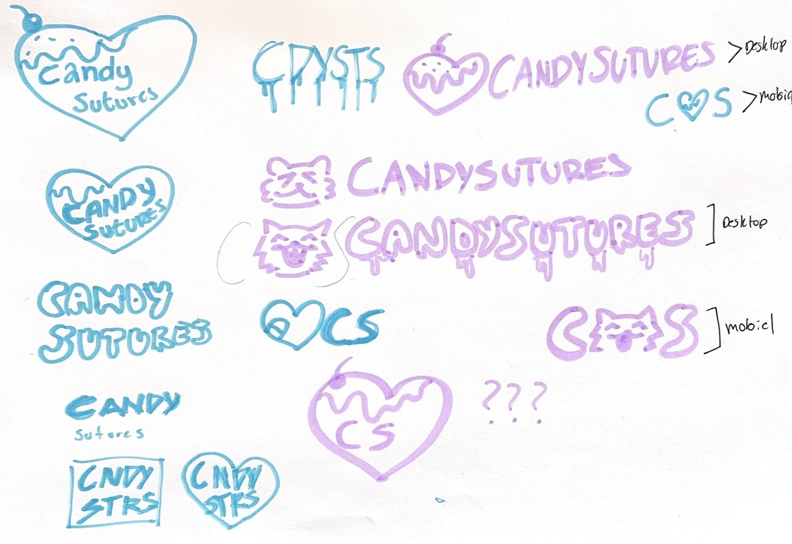

 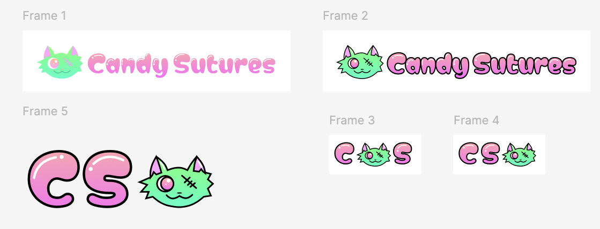
 

### Checkout: 

Leg uit wanneer een website 'lelijk' wordt en geef voorbeelden wat je kan doen om deze 'lelijke' onderdelen te fixen?
Je kan max width toevoegen, padding, display grid gebruiken om tekst beter en leesbaar maken.

Vertel welke volgende stap je neemt om je website responsive te maken.
Ik moet heel veel doen, maar sowieso moet ik mijn mobiel media query af maken, ik ben niet super ver.

Kun je het ontwerp en de bouw van je eigen Garden (zo uit je hoofd) onderbouwen in Webby vocabulair?
- Lowkey geen idee. 

